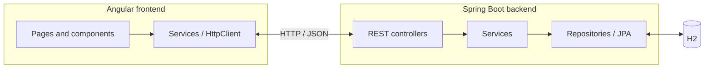
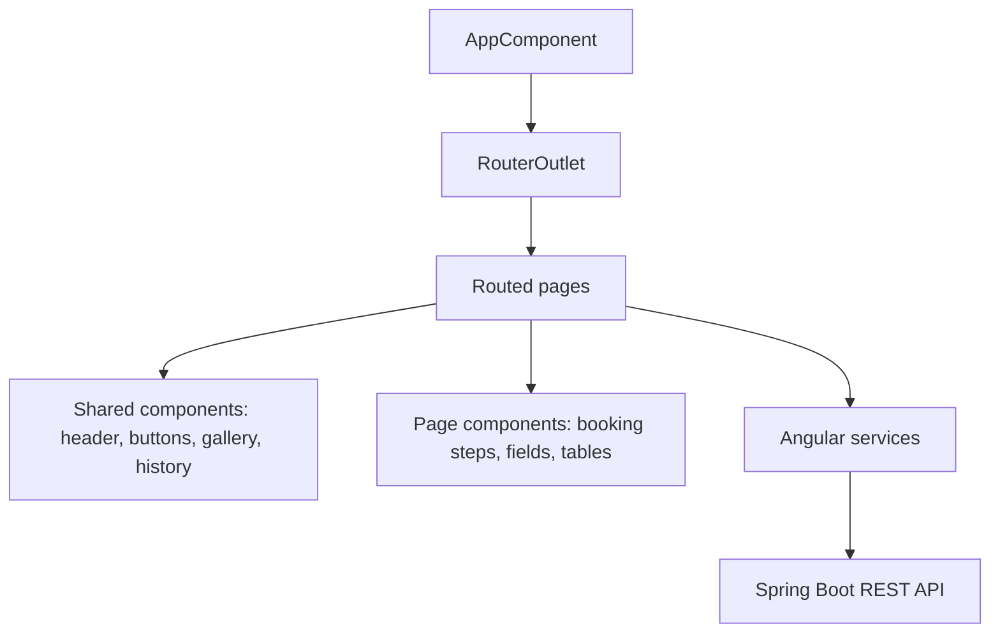

# Atlan Suites


Hotel management application built with **Angular 19** and **Spring Boot**. Guests can explore room types and services, book a stay and consult their reservations. Staff manage clients, rooms, services and reservation histories. Payments are simulated and stored in H2. The booking total is the nightly rate × nights plus selected services. An initial payment must be at least COP 100,000 and cannot exceed the booking total.

## Color palette


## Project structure

```text
Angular-Frontend/                    Angular frontend
  src/app/
    pages/                          Routed screens and their own components
    components/                     Shared UI components
    services/                       Stateless HTTP communication
    models/                         TypeScript interfaces and enums
    app.routes.ts                   Application routes
  public/                           Runtime images and video
Springboot-Backend/                 Spring Boot backend
  src/main/java/com/example/demo/
    controller/                     REST endpoints
    service/                        Application logic
    repository/                     Database access with Spring Data JPA
    entities/                       Persistent domain model
readme-assets/                      Logo, palette and database diagram
README.md
```

## REST architecture

Angular renders the interface and sends HTTP requests. Spring Boot processes them, reads or writes H2, and returns JSON.



## Booking implementation

`BookingService` prepares and creates new bookings (availability, quotes and room allocation). `ReservationService` and its implementation, `ReservationServiceImpl`, query and manage existing reservations (editing, deletion, detailed reads and client history). Both use `ReservationRules` for the existing date, capacity and service-selection rules, without depending on each other. `ReservationBillingService` handles folios, contracted service prices, simulated payment records and financial details. `BookingPaymentValidator` checks the transient card input and reports all rejected fields together. Dependencies are supplied through constructors; these classes use the existing repositories and error responses.

| Service | Operation | Stages |
| --- | --- | --- |
| `BookingService` | `listAvailableRoomTypes` | Validate the stay → query available rooms → group by room type. |
| `BookingService` | `quoteReservation` | Validate dates and capacity → resolve active services → calculate nights and totals. |
| `BookingService` | `createReservation` | Resolve the client → lock the room type → quote and recheck availability → validate optional payment → save reservation, folio and charges → return details. |
| `ReservationServiceImpl` | `updateReservation` | Lock the reservation → validate the changes and lock the room type → keep or reassign a room → resolve services → reconcile charges and balance → apply the reservation and folio statuses. |
| `ReservationServiceImpl` | `deleteReservation` | Lock the reservation → delete payments, charges and folio → delete the reservation. |
| `ReservationServiceImpl` | `listClientHistory` | Read the client's reservation list → compose each reservation's details. |
| `ReservationServiceImpl` | `readReservationDetails` | Find the reservation → read its folio, charges and payments → calculate totals and balance. |

The room-type lock remains held until the transaction completes, so availability is checked after acquiring it. Editing preserves existing nightly rates when the room type is unchanged and preserves retained service charge snapshots. New charges use current catalog prices. Financial changes and reservation changes commit or roll back together.

On Angular, `BookNowComponent` reconstructs the draft from query parameters, verifies the prerequisites for the requested step and loads that step's data. Saving is a separate request from those cancellable reads. Card data is sent only in the POST body.

## Angular components

The router chooses the page displayed inside `RouterOutlet`. Each page combines shared components with components used only by that page.



Frontend reactive state uses RxJS Observables and Subjects, consumed through `async`. Component inputs use `@Input`. Outputs expose read-only Observables backed by local Subjects, with `@Output` aliases preserving template event names. The application does not use Angular signals or EventEmitter. Route-dependent detail queries cancel superseded reads with `switchMap`.

## Reading the code

Prefer explicit steps and ordinary loops for selection and totals. Keep framework mechanisms when they solve a concrete problem, and explain their role near the relevant flow. Pages coordinate HTTP calls and navigation, child components present fields or emit user actions, and services handle backend communication. Comments explain decisions and unfamiliar mechanisms rather than narrating each line.

| Construct | Role in this project |
| --- | --- |
| Java `Optional`, `orElse` and `orElseThrow` | Represent a query that may find nothing, then choose a fallback or the existing error. |
| Java `record` and DTO constructors | Group the fields returned to Angular without exposing the full persistence entity. |
| `@Transactional` and pessimistic locks | Keep reservation and folio changes together and serialize conflicting assignments. |
| JPQL `SELECT new`, `JOIN` and `LEFT JOIN` | Build a DTO directly from entity fields. `JOIN` follows a relationship, while `LEFT JOIN` also keeps rows whose related record is absent. Long projections list fields in constructor order. |
| JPQL `NOT EXISTS` and stay dates | Keep a room only when no conflicting reservation exists. Strict `<` and `>` comparisons allow one stay to start on the day another ends. |
| Angular `@Input`, `@Output` and RxJS `Subject` | Pass data into a child and publish its actions. The child emits through a protected Subject and exposes `asObservable()` for its parent to listen. |
| RxJS `Observable` and names ending in `$` | Represent values or HTTP results that arrive asynchronously. `pipe` connects the processing steps, and `map` transforms each emitted value. |
| `switchMap` and `forkJoin` | Cancel superseded reads or wait for several HTTP queries to finish together. |
| `concatMap` and `exhaustMap` | Keep dependent operations in order or ignore repeated submissions while the current request finishes. Recoverable errors stay inside each action so a later submission still works. |
| `fromEvent` and `timer` | Listen to browser events and manage delayed actions. Component destruction releases listeners and cancels pending waits. |
| `BehaviorSubject` and `combineLatest` | Store local selections and recalculate a view when its data or filters change. |
| `AsyncPipe` and `takeUntilDestroyed` | Subscribe for rendering or component logic and release the subscription with the component. |

## Navigation

Public pages: `/`, `/login`, `/services-catalog`, `/services-catalog/:id` and `/room-types/:id`. Client pages use `/profile?auth=1`, `/profile/edit?auth=1` and `/book-now?auth=1&step=dates`; the URL is the only user context. Staff use `/admin/:adminId` and `/operator/:operatorId`, with no session or role guards. The operator landing route opens their profile with access to clients and reservations.

Staff reservation management is available at `/admin/:adminId/reservations` and `/operator/:operatorId/reservations`. Both include search, filters, sorting, table/grid views, detail (`/:id`) and editing (`/:id/edit`). Detail and editing share the same layout, dark guest information card and read-only financial history. Staff pages identify their context with “Admin view” or “Operator view”, while client details omit that title. Editing covers dates, guests, room type, services and status; contracted prices and recorded payments are preserved. A pending reservation cannot be changed directly to checked-in. Both the edit form and the backend reject that transition with an error on the status field. Price-changing edits with existing payments require a new total greater than the amount paid; an increased fully paid booking becomes pending. Client views under both staff panels reuse the client reservation cards with enum-status filters and read-only detail navigation, without ratings or Book again. Permanent deletion removes the reservation, folio, charges and payments after confirmation in an in-app dialog warning that the action is irreversible. Cancelling normally preserves that history.

Rooms and services have an independent `activationStatus` (`ACTIVE` / `INACTIVE`). Room physical status and service schedules remain separate. Inactive records cannot be selected for new bookings; management uses Activate/Deactivate instead of deleting them.

Client 1 (Emma Thompson) has nine demonstration bookings covering every reservation status, unpaid and partial balances, full payments and payments split into three installments. Every demonstration reservation has a folio; confirmed and completed stays include full simulated payments, while pending bookings retain unpaid or partial balances. Room occupancy matches checked-in stays. Demonstration dates are consistent with October 18, 2026; future stays are dated in 2027. Ratings and Book again are visual only. Clicking a reservation card or Details opens `/reservation/:id?auth=1`, with stay and guest information, service charges, folio, totals and payment history.

Every API error returns the same JSON body: `status`, `error`, `message`, `path` and, when specific fields are rejected, `fieldErrors` with one message per field. Bean Validation on the entities and the services' business rules (unique values, existing related records, booking and payment checks) report the rejected fields, and each form shows the message under its field; other errors appear in the form alert, adapted to the HTTP status. General submission and validation alerts appear below the form’s save or submit actions, while field errors remain beside their inputs. Unexpected server errors return 500 without technical details. Booking errors distinguish invalid dates or guests, excessive capacity, unavailable rooms, inactive services and invalid card details. A stay lasts at most 90 nights and can start up to two years ahead; card payments require 13–19 digits, an unexpired MM/YY date and a 3–4 digit security code.

The Angular forms apply the same rules and messages before sending (`utils/form-validators.ts` and `utils/form-messages.ts`), so every restriction exists on both sides. Inputs stop at the column length, phone fields accept only digits and a leading +, card fields accept only digits up to their maximum, the booking calendar only offers valid dates and the guest counter stops at 10.

When the main content of a page cannot load, an error screen replaces it inside the same area (public site, `/admin/:adminId` or `/operator/:operatorId`) without changing the URL (`utils/error-page.ts`, `pages/error-page`): 400 for an invalid value in the address, such as `/admin/1/rooms/abc`; 404 for a missing record or an unknown route; 500 when the server fails; and 503 when it cannot be reached. Try again reloads the original address. Form submissions, list actions (delete, activate), login, booking rule errors (4xx) and the landing sections keep their messages on the page.

## Entity–relationship diagram

Reference model for users, accommodation, reservations, hotel services, folios and payments.


## Run locally

Requires an Angular 19-compatible Node.js version, npm, a complete JDK 17 or later, and Make. Run each application in a separate terminal:

```bash
make -C Springboot-Backend serve
```

```bash
make -C Angular-Frontend serve
```

Use `make check` in each application directory to verify the frontend types/build or backend compilation/packaging. Automated tests are not configured.

When `lsof` is available, the backend's `make serve` detects an existing process using the project's H2 database and reports it instead of starting a second instance.

[Application](http://localhost:4200) · [Swagger API](http://localhost:8080/swagger-ui/index.html) · [Figma](https://www.figma.com/design/AzKmb3UaMsc4t8JZCZXiL4/AtlanSuites?node-id=0-1)
