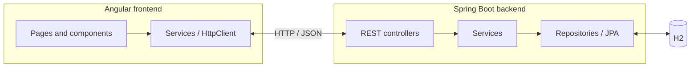
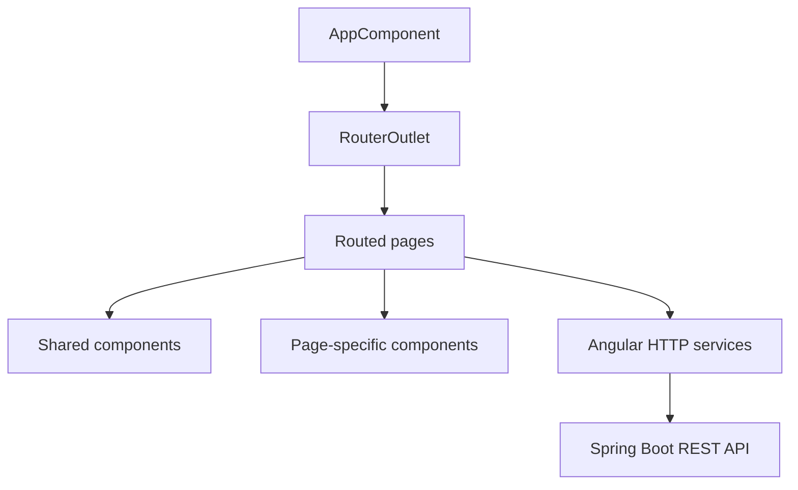

# Atlan Suites


Hotel management application built with Angular and Spring Boot. It supports public accommodation and service catalogs, reservations with optional services, simulated card payments and refunds, client reservation history, staff management, an operator front desk board and administrator reporting.

## Technology stack

| Area | Technologies and purpose |
| --- | --- |
| Frontend | Angular 19 standalone components, Angular Router, TypeScript 5.7 and SCSS. Client-side rendering, with SSR disabled. |
| Reactive state | RxJS 7.8 for HTTP composition, route-driven reads and local component events. |
| Translations | Transloco 8.4 with JSON dictionaries per language; Angular locale data formats dates, numbers and currency. |
| Charts | Apache ECharts 6.1.0, imported directly without an Angular wrapper. |
| Backend | Spring Boot 4.1.0, Java 17+, Spring MVC and constructor-based dependency injection. |
| Persistence | Spring Data JPA, Hibernate and H2. Lombok generates entity accessors. |
| Validation | Bean Validation and service-level business rules, with structured API errors. |
| API documentation | Springdoc OpenAPI 3.1.1 generates the API specification and Swagger UI. |
| Build tools | Project-local Angular CLI and npm, Maven Wrapper and Make. |

## Project structure

```text
Angular-Frontend/
  src/app/
    pages/                          Routed pages and their local components
    components/                     Components shared across pages
    services/                       HTTP communication
    models/                         TypeScript interfaces and enums
    utils/                          Shared form and navigation helpers
    app.routes.ts                   Route definitions and lazy loading
  public/                           Static runtime assets
    i18n/                           Translation dictionaries (en.json, es.json)
    icons/                          Dashboard metric icons
    images/                         Application images
  scripts/check-i18n.mjs            Translation checker run by make i18n
Springboot-Backend/
  src/main/java/com/example/demo/
    controller/                     REST endpoints
    service/                        Application logic and transactions
    repository/                     Spring Data JPA queries
    entities/                       Persistent domain model
    dto/                            API read models and reporting aggregates
    exception/                      Structured API error handling
  src/main/resources/
    application.properties          Server, persistence and API configuration
readme-assets/                      README images and PlantUML diagram source
```

## Architecture and API contracts

Angular owns rendering and navigation. Its services use `HttpClient` to exchange JSON with Spring Boot. Backend controllers delegate application operations to services, which use repositories for persistence. Transaction boundaries belong to the service layer.



Read DTOs and repository projections select the fields needed by each screen instead of returning complete persistence graphs. Java dates use ISO strings in Angular, with date-only values kept as `YYYY-MM-DD`. TypeScript models use explicit enum values matching Java and optional properties for absent data. Strict null checking, `noUncheckedIndexedAccess`, `exactOptionalPropertyTypes` and Angular strict template checking are enabled.

API resources use paths such as `/clients`, `/rooms` and `/reservations`, without an `/api` prefix. Controllers allow the fixed development origin `http://localhost:4200`. API errors carry `status`, `error`, `message`, `path` and optional `fieldErrors`; shared frontend helpers map field errors and page-loading failures into the interface.

The application currently uses route identifiers as user context rather than authenticated sessions or role guards. Administrator and operator routes organize the interface but do not constitute an authorization boundary. Payments and refunds are simulated, with no external payment gateway.

## Angular composition and reactive state

`AppComponent` contains `RouterOutlet`. Routed pages coordinate data loading and navigation, shared components live under `components/`, and components used by only one page live under that page. Templates and SCSS remain in external files. Only the landing page composes the public header and footer.



Inputs use `@Input`. Component outputs expose read-only Observables backed by local Subjects through `@Output` aliases. State uses RxJS rather than signals or `EventEmitter`.

| Mechanism | Technical decision |
| --- | --- |
| `switchMap` | Replace stale route-dependent reads and cancel superseded HTTP requests. |
| `forkJoin` | Combine independent finite HTTP requests. |
| `concatMap` / `exhaustMap` | Preserve operation order or ignore repeated submissions while an operation is running. |
| `BehaviorSubject` / `combineLatest` | Combine local selections and loaded data without a global event bus. |
| `AsyncPipe` / `takeUntilDestroyed` | Release subscriptions with their owning component. |
| Inner `catchError` | Recover individual requests without terminating a reusable action stream. |

Booking navigation uses an explicit `step` query parameter. The draft persists across steps, and date changes invalidate dependent selections. Card data is sent in the request body and never placed in the URL, stored or returned. Static files under `public/` are served from the frontend root, for example `/icons/wallet.png`.

## Translations

The interface is available in English, Spanish, French, Portuguese, Simplified Chinese, Russian, Arabic and Hebrew. **Language** at the end of the public header menu lists the available languages and marks the current one. Choosing another language saves its code in `localStorage` (`atlan-language`) and reloads the page; the saved choice applies to every page, including the staff area. This is the only value the application keeps in browser storage.

`app.config.ts` reads the saved language before Angular starts. It configures Transloco, sets `LOCALE_ID` (for example `en-US`, `es-CO` or `ar`) and, before the first render, loads the dictionary and that language's Angular locale data, so the date, number and currency pipes follow the language. Locale data is downloaded only for the chosen language, keeping it out of the initial bundle. Arabic and Hebrew also set `dir="rtl"` on the page, and flex and grid layouts mirror automatically. English is the fallback: a key missing from another dictionary shows its English text.

| Piece | Location |
| --- | --- |
| Available languages and the saved choice | `src/app/utils/language.ts` |
| Dictionaries, one per language with the same keys | `public/i18n/<code>.json` |
| HTTP loader for the dictionaries | `src/app/transloco-loader.ts` |
| Checker for keys and hardcoded template text | `scripts/check-i18n.mjs` (`make -C Angular-Frontend i18n`) |

Every visible text goes through a key. Templates use the `transloco` pipe:

```html
<h1>{{ 'rooms.list.title' | transloco }}</h1>
<app-skeleton [label]="'rooms.list.loading' | transloco" />
<button [attr.aria-label]="'common.closeNotification' | transloco">✕</button>
<p>{{ 'rooms.roomNumber' | transloco: { number: room.number } }}</p>
<span>{{ 'enums.roomStatus.' + room.status | transloco }}</span>
<p>{{ (saving ? 'common.saving' : 'rooms.form.save') | transloco }}</p>
```

TypeScript uses `translate('key', params)` from `@jsverse/transloco` inside methods, getters, callbacks or component fields, never in module-level constants, which run before the dictionary loads. Constants and models store keys instead, and properties that hold keys end in `Key` (`labelKey`, `titleKey`). Form messages in `form-messages.ts` are keys that `FormFieldComponent` translates; its `messageParams` input fills placeholders such as `{{ years }}`.

Plurals use two keys (`nightsOne`, `nightsMany`). Each enum value needs an `enums.<enumName>.<VALUE>` key. Data from the database (names, descriptions, categories) and messages written by the backend are shown as received, in English.

To add a language, copy `en.json` to `public/i18n/<code>.json`, translate its values, add the language to `LANGUAGES` in `language.ts` (with its locale and writing direction), and add a loader for its Angular locale data to `LOCALE_DATA` in `app.config.ts`. ECharts writes its own accessible chart descriptions; if ECharts ships that language, declare `echarts/i18n/lang<CODE>-obj.js` in `echarts-locales.d.ts`, register it in `analytics-chart.component.ts` and list it in `allowedCommonJsDependencies` in `angular.json`. Languages ECharts does not ship (Hebrew) fall back to its English texts. `make -C Angular-Frontend i18n` reports dictionaries with missing or extra keys, keys used in code that do not exist, enum values without translation and visible text written directly in templates.

## Reservation consistency and billing

| Collaborator | Responsibility |
| --- | --- |
| `BookingService` | Availability, quotes and creation with physical room allocation. |
| `ReservationServiceImpl` | Existing reservation reads, edits, cancellation, deletion and client history. |
| `ReservationRules` | Shared date, capacity and service-selection rules. |
| `ReservationBillingService` | Folios, historical charge snapshots, simulated payments and refunds. |
| `BookingPaymentValidator` | Validation of transient card inputs. |

Creation locks the selected room type inside the transaction and rechecks overlapping non-cancelled reservations before assigning a physical room. Availability uses strict overlap boundaries, allowing one stay to begin on another's checkout date. The room count returned by `GET /reservations/available-room-types` is a search snapshot, not an allocation guarantee.

Edits lock the reservation and the relevant room type. Retained nightly rates and service charges preserve their contracted price snapshots; newly added charges use current catalog prices. Reservation, folio and financial changes commit or roll back together. Rooms and services use `activationStatus` independently of physical room status or service schedules, preserving historical references while excluding inactive options from new bookings.

Clients can open **Modify** from their reservation history or **Edit reservation** from its detail. `PUT /reservations/{id}/client?clientId=...` changes dates, guest count and selected services for pending or confirmed reservations whose arrival has not passed. The server checks the reservation owner and preserves the booked room type, owner and status; payment coverage can update the status automatically. Availability and capacity are checked again when saving. The form previews the new total and any refund.

The client profile links to **Payments & refunds**, a chronological view of payments and refunds across all of that client's reservations. It uses the existing `GET /reservations/history?clientId=...` response, shows approved paid, refunded and net totals, and lets the client filter the records or open the related reservation. The current URL-based client context applies to this page as well.

When an edit reduces the total below net paid, the difference is recorded as an approved `MODIFICATION` refund. Existing `PAYMENT` rows remain unchanged. Previous approved refunds are deducted before calculating a new refund, including a later cancellation. Equal totals do not generate refunds. Fully covered pending reservations become confirmed; a price increase on a fully paid reservation creates an outstanding balance and returns it to pending.

**Add card payment** in the client reservation detail reuses the booking card form. `POST /reservations/{id}/payments?clientId=...` accepts an amount and transient card details, validates the owner and the current balance under the reservation lock, and inserts a new approved `CARD` payment. Cancelled and checked-out reservations cannot receive payments, nor can pending or confirmed stays whose departure date has arrived. Checked-in guests can pay until check-out, including on the departure day or after an overdue departure. The usual minimum is COP 100,000; if the remaining balance is smaller, it must be paid in full. Overpayments are rejected. Paying the full balance marks the folio paid and confirms a pending reservation. Card data is neither persisted nor returned. These are simulated operations under the existing URL-based user context, not a payment gateway or authenticated session.

An operator can choose **Receive cash payment** on a reservation's detail page. `POST /reservations/{id}/cash-payments?operatorId=...` validates the operator and the current balance under the same reservation lock, then records an approved `CASH` payment with that operator. It applies the same amount limits and accepts the exact remaining balance when below COP 100,000. The API sets the method, status and operator from server-side data; values supplied for those fields in the request body are ignored. Card and cash payments share the folio and reduce one balance. If a later edit or cancellation requires a refund, cash paid is returned as `CASH` first and any remainder as `CARD`, with both methods recorded in `REFUND`.

Backend regression tests run with `./mvnw test` (Windows: `mvnw.cmd test`) against H2 in memory, independently of the local database file.

Cancellation preserves the reservation, folio, prices, charges and payments. In the same locked transaction, approved payments minus existing approved refunds determine the amount to refund. Client cancellation and staff edits that set the status to `CANCELLED` share the same refund operation. It records an approved `CANCELLATION` refund with no operator, method `CARD` and empty notes. Staff edits retain their existing charge reconciliation before refunding. Repeated cancellation does not create duplicate refunds. Permanent staff deletion is a separate operation that removes the associated financial records.

Net paid is approved payments minus approved refunds. Active reservation balances use contracted totals minus net paid; cancelled reservations retain their historical totals but have no outstanding balance. Billing calculations use Java decimal values, while frontend numeric values are for presentation.

## Operator front desk

After signing in, operators land on the front desk at `/operator/:operatorId`; their profile is at `/operator/:operatorId/profile`. `GET /front-desk` follows `FrontDeskController → FrontDeskServiceImpl → repositories` and returns four lists for the server date in one read-only, repeatable-read transaction:

| List | Contents |
| --- | --- |
| Arrivals | Pending and confirmed reservations whose check-in is today or earlier and whose check-out has not arrived. Late arrivals are flagged. |
| In-house guests | Checked-in reservations, nearest departure first. |
| Pending departures | Checked-in reservations whose check-out date is today or has passed. |
| Rooms to prepare | Active rooms in `CLEANING` or `MAINTENANCE`. Rooms assigned to a pending arrival come first. |

Each stay includes its balance, computed like the reservation detail: contracted total minus net paid. The board shows an action only when it should succeed, and the server validates it again:

| Action | Rule | Effect |
| --- | --- | --- |
| `PUT /reservations/{id}/check-in` | Confirmed reservation whose stay includes today, with its room `AVAILABLE`. | Reservation `CHECKED_IN`, room `OCCUPIED`. |
| `PUT /reservations/{id}/check-out` | Checked-in reservation with a zero balance. | Reservation `CHECKED_OUT`, room `CLEANING`. A room in `MAINTENANCE` keeps that status. |
| `PUT /rooms/{id}/ready` | Room in `CLEANING` or `MAINTENANCE`. | `AVAILABLE`, or `OCCUPIED` while a guest is still checked in. |

Check-in and check-out lock the reservation like the other reservation changes. Rooms being cleaned remain bookable; only `MAINTENANCE` excludes a room from availability. Pending arrivals and departures with a balance link to the reservation detail with `?from=front-desk`, where the operator can receive a cash payment and return to the board. The board reloads after every action, so changes made by other operators appear and stale actions show the server's reason.

The staff reservation form still changes the status manually without touching the room status; administrators adjust rooms from **Rooms** when needed. `DataLoader` adds reservations ATL-2026-0014 to ATL-2026-0019 with dates relative to the startup day, so the board always shows arrivals, in-house guests, departures with and without a balance and a room being cleaned before an arrival. `FrontDeskTest` covers the lists and the three actions.

## Reporting and Apache ECharts

Accounting uses **[Apache ECharts 6.1.0](https://echarts.apache.org/handbook/en/basics/import/)** directly. The accounting route is lazy-loaded, keeping its chart code outside the initial application bundle. Only the required pie, line and bar charts, SVG renderer, grid, graphic, tooltip, legend, zoom, toolbox and accessibility modules are registered.

`accounting-chart-options.ts` converts aggregate DTOs into chart options. `AnalyticsChartComponent` owns the ECharts instance and its lifecycle. It initializes rendering outside Angular's zone, resizes through `ResizeObserver`, honors reduced-motion preferences and disposes the instance and observer on destruction. Tooltips use `richText` rather than HTML. Legends, segment selection and timeline zoom provide interaction; the toolbox restores the view and exports SVG images. Chart texts come from the translation dictionaries, and each chart starts with the ECharts locale of the current language, which writes its generated accessible description. Semantic tables expose the same aggregate values without relying on charts.

`GET /accounting?from=2026-01-01&to=2027-12-31` follows `AccountingController → AccountingServiceImpl → AccountingRepository`. `AccountingDashboard` contains only financial totals, status counts, monthly trend points, rankings and stay averages. Database-side aggregation avoids transferring individual reservations or financial movements to Angular.

The service uses a read-only repeatable-read transaction. Timestamp predicates use an inclusive start and exclusive next-day end. H2 `DATE_TRUNC` groups the trend by calendar month, and the service fills missing months with zero. Partial-month counts remain restricted to the requested dates. H2 `DATEDIFF` computes contracted nights.

Financial sums use payment and refund movement dates. Reservation cohorts use creation dates. Status distribution includes pending, confirmed and checked-in reservations, with percentages computed over those three states. Rankings and stay averages exclude cancelled reservations. Service values come from historical folio charge snapshots, and separate correlated sums prevent payment/refund joins from multiplying amounts.

These aggregates are current snapshots over retained records. Net collections are not profit, scheduled nights are not measured occupancy, and deleting records affects later reports.

## Database model

Hibernate maps users, accommodation, reservations, services, folios, payments, refunds and ratings to H2. Payments and refunds belong to a reservation's folio, preserving the original payment records when money is returned. Ratings belong to reservations.


The diagram source is [`entity-relationship.puml`](readme-assets/entity-relationship.puml). It uses PlantUML's built-in layout engine, without Graphviz:

```bash
java -jar plantuml.jar -tpng readme-assets/entity-relationship.puml
```

The development datasource is `jdbc:h2:file:./data/atlan-suites`, relative to `Springboot-Backend/`, with username `sa` and an empty password. The current `hibernate.ddl-auto=create-drop` configuration recreates the schema for the application lifecycle; the file datasource does not imply durable data across restarts. `DataLoader` supplies demonstration data. The H2 console is exposed at `/h2`.

## Visual assets

Application assets remain under `Angular-Frontend/public/`. README illustrations and the database diagram source remain under `readme-assets/`.


## Local development and verification

Requirements: an Angular 19-compatible Node.js version, npm, a complete JDK 17 or later and Make. The frontend uses its local CLI, and the backend uses Maven Wrapper.

Run each application in a separate terminal from the repository root:

```bash
make -C Springboot-Backend serve
```

```bash
make -C Angular-Frontend serve
```

The frontend Makefile installs locked dependencies with `npm ci` when needed. The backend Makefile resolves `JAVA_HOME` from `javac` unless overridden. When `lsof` is available, it detects an existing process using the project's H2 file before starting a second backend instance.

| Command | Verification |
| --- | --- |
| `make -C Angular-Frontend check` | TypeScript checking, translation check and production build. |
| `make -C Springboot-Backend check` | Maven clean verification lifecycle, including compilation and packaging. |

The backend has JUnit/H2 regression tests; the frontend has no automated test script yet. The frontend defaults to port `4200` and the backend to `8080`; `SERVER_PORT` overrides the backend port, while frontend HTTP service URLs currently target `http://localhost:8080`.

- [Application](http://localhost:4200)
- [Swagger UI](http://localhost:8080/swagger-ui/index.html)
- [OpenAPI JSON](http://localhost:8080/v3/api-docs)
- [Figma design](https://www.figma.com/design/AzKmb3UaMsc4t8JZCZXiL4/AtlanSuites?node-id=0-1)
