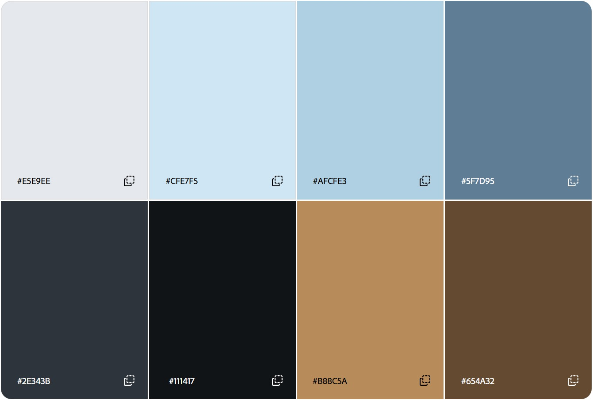
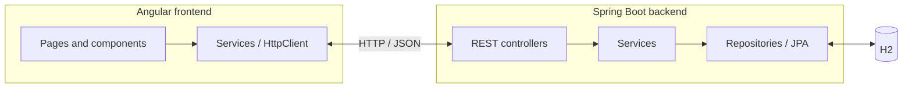
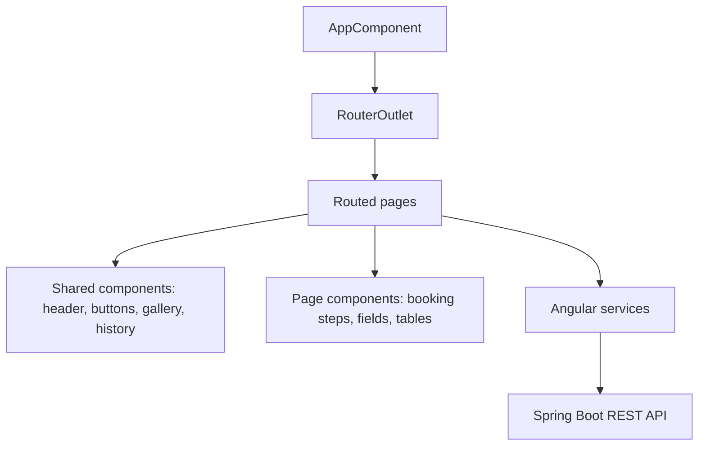
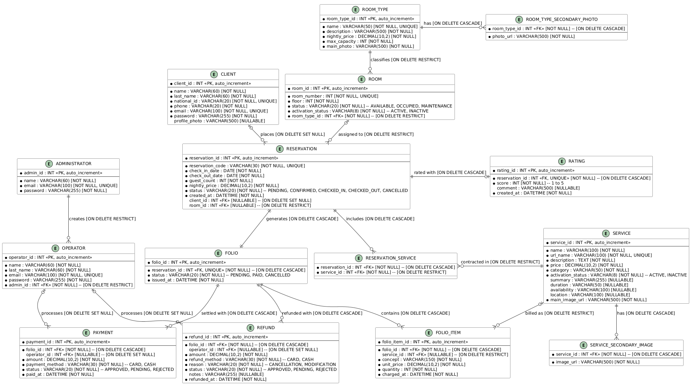

# Atlan Suites


Hotel management application built with **Angular 19** and **Spring Boot**. Guests can explore room types and services, book a stay and consult their reservations. Staff manage clients, rooms, services and reservation histories. Payments are simulated and stored in H2. The booking total is the nightly rate × nights plus selected services. An initial payment must be at least COP 100,000 and cannot exceed the booking total.

## Color palette



## Project structure

```text
Angular-Frontend/                    Angular frontend
  src/app/
    pages/                          Routed screens and their own components
    components/                     Shared UI components
    services/                       Stateless HTTP communication
    models/                         TypeScript interfaces and enums
    app.routes.ts                   Application routes
  public/                           Runtime images and video
Springboot-Backend/                 Spring Boot backend
  src/main/java/com/example/demo/
    controller/                     REST endpoints
    service/                        Application logic
    repository/                     Database access with Spring Data JPA
    entities/                       Persistent domain model
readme-assets/                      Logo, palette and database diagram
README.md
```

## REST architecture

Angular renders the interface and sends HTTP requests. Spring Boot processes them, reads or writes H2, and returns JSON.



## Angular components

The router chooses the page displayed inside `RouterOutlet`. Each page combines shared components with components used only by that page.



Frontend reactive state uses RxJS Observables and Subjects, consumed through `async`. Component inputs use `@Input`; the application does not use Angular signals. Route-dependent detail queries cancel superseded reads with `switchMap`.

## Navigation

Public pages: `/`, `/login`, `/services-catalog`, `/services-catalog/:id` and `/room-types/:id`. Client pages use `/profile?auth=1`, `/profile/edit?auth=1` and `/book-now?auth=1&step=dates`; the URL is the only user context. Staff use `/admin/:adminId` and `/operator/:operatorId`, with no session or role guards. The operator landing route opens their profile with access to clients and reservations.

Staff reservation management is available at `/admin/:adminId/reservations` and `/operator/:operatorId/reservations`. Both include search, filters, sorting, table/grid views, detail (`/:id`) and editing (`/:id/edit`). Editing covers dates, guests, room type, services and status; contracted prices and recorded payments are preserved. Price-changing edits with existing payments require a new total greater than the amount paid; an increased fully paid booking becomes pending. Client views under both staff panels reuse the client reservation cards with enum-status filters and read-only detail navigation, without ratings or Book again. Permanent deletion removes the reservation, folio, charges and payments after an irreversible-action warning. Cancelling normally preserves that history.

Rooms and services have an independent `activationStatus` (`ACTIVE` / `INACTIVE`). Room physical status and service schedules remain separate. Inactive records cannot be selected for new bookings; management uses Activate/Deactivate instead of deleting them.

Client 1 (Emma Thompson) has nine demonstration bookings covering every reservation status, unpaid and partial balances, full payments and payments split into three installments. Every demonstration reservation has a folio; confirmed and completed stays include full simulated payments, while pending bookings retain unpaid or partial balances. Room occupancy matches checked-in stays. Demonstration dates are consistent with October 18, 2026; future stays are dated in 2027. Ratings and Book again are visual only. Clicking a reservation card or Details opens `/reservation/:id?auth=1`, with stay and guest information, service charges, folio, totals and payment history.

Booking errors distinguish invalid dates or guests, excessive capacity, unavailable rooms and inactive services. Spring includes the error message in its default response so the frontend can display the reason.

## Entity–relationship diagram

Reference model for users, accommodation, reservations, hotel services, folios and payments.



## Run locally

Requires an Angular 19-compatible Node.js version, npm, a complete JDK 17 or later, and Make. Run each application in a separate terminal:

```bash
make -C Springboot-Backend serve
```

```bash
make -C Angular-Frontend serve
```

Use `make check` in each application directory to verify the frontend types/build or backend compilation/packaging. Automated tests are not configured.

When `lsof` is available, the backend's `make serve` detects an existing process using the project's H2 database and reports it instead of starting a second instance.

[Application](http://localhost:4200) · [Swagger API](http://localhost:8080/swagger-ui/index.html) · [Figma](https://www.figma.com/design/AzKmb3UaMsc4t8JZCZXiL4/AtlanSuites?node-id=0-1)
